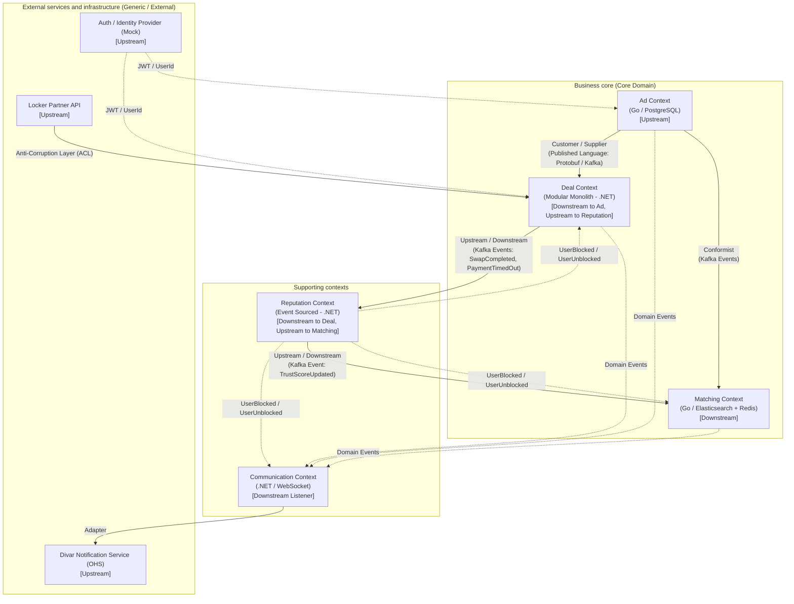

# Context Map of the Taakht System

This document defines the relationships, dependencies and integration patterns between the Bounded Contexts of the Taakht system, following Domain-Driven Design.

---

## 1. Overview of the context map

---

## 2. Description of the relationships and integration patterns

### 2.1. Ad and Deal (the central core of the transactions)
- **Direction:** `Ad` is upstream and `Deal` is downstream.
- **Integration pattern:** **Customer / Supplier** with a **Published Language** (Protobuf over Kafka and gRPC contracts).
- **Architectural analysis:** The Deal service depends on Ad's data and events to check the state of the item and to create the agreement. Events such as `AdEdited` cause active proposals in Deal to be replaced (`RebaseProposal`). At final agreement, Deal sends the `ClaimLock` command to Ad through the Saga coordinator. Because Deal is Ad's direct customer, the requirements of the lock interface and of the Ad events are set by mutual agreement.

### 2.2. Ad and Matching
- **Direction:** `Ad` is upstream and `Matching` is downstream.
- **Integration pattern:** **Conformist**.
- **Architectural analysis:** Matching only builds a read model in Elasticsearch and Redis from Ad events (`AdPublished`, `AdEdited`, `AdHidden`, `AdClosed`). It imposes no structure or special requirement on the Ad service and fully follows the Ad data model.

### 2.3. Deal and Reputation
- **Direction:** `Deal` is upstream and `Reputation` is downstream.
- **Integration pattern:** asynchronous event-driven (domain events).
- **Architectural analysis:** Reputation consumes the deal end or cancellation events (`SwapCompleted`, `PaymentTimedOut`, `SwapCancelled`) from Deal to build the user's event stream and to apply negative marks or open the review question. Deal does not need to know the formula details or how Reputation stores its data.

### 2.4. Reputation and Matching
- **Direction:** `Reputation` is upstream and `Matching` is downstream.
- **Integration pattern:** **Conformist** with a domain event.
- **Architectural analysis:** Matching listens to the `TrustScoreUpdated` event to update its local copy of users' trust scores in its Elasticsearch index and to use it in the search ranking formula and in penalising offending users.

Blocking also flows from Reputation: `UserBlocked` / `UserUnblocked` are consumed by Deal (refuse new requests, withdraw open negotiations), Matching (hide Ads, no `MatchFound`) and Communication (refuse messages). Each consumer keeps a local copy of the blocked pairs, so a small eventual-consistency window exists.

### 2.5. The delivery (locker) partner and the Swap module in Deal
- **Direction:** `Locker Partner` is upstream and `Swap` is downstream.
- **Integration pattern:** **Anti-Corruption Layer (ACL)**.
- **Architectural analysis:** The locker partner's API (Ganjeh or another commercial partner) is independent of the Taakht domain, so changes to its model or webhooks must not leak into the clean Swap domain model. The ACL translates the partner's raw webhook data and API responses into the `DeliveryProvider` interface contract and internal domain events.

### 2.6. The Communication context
- **Direction:** fully downstream (**Downstream / Conformist**) to the events of the Taakht system, and at the same time a consumer of Divar's messaging system.
- **Architectural analysis:** This service listens to domain events (`MatchFound`, `AdEdited`, `AgreementReached`, ...) and translates these business facts into human-readable text, then delivers them through the `NotificationProvider` adapter to Divar's public messaging system (Open Host Service). The direct chat module also lives in this context for demo purposes.

### 2.7. The User / Auth context
- **Direction:** upstream **Generic Subdomain** that injects the identity (`UserId`) into the JWT token.
- **Architectural analysis:** In the demo it is a mock, and the other services only extract the valid identity from the gateway headers.

---

## 3. Subdomain classification

| Context | Class | Depth in the first version | Why |
|---|---|---|---|
| Matching | Core | Full | The heart of the product; where concurrency and ranking are shown |
| Ad | Core | Full | Versioned Ads and the atomic exclusive lock |
| Deal (Negotiation and Swap) | Core | Full | The consistency-critical flows: proposals, approvals, the lock Saga, binding agreements |
| Reputation | Supporting | Minimal to shallow | Real (event-sourced), but it also holds blocking and abuse reports, so it is a little more than minimal |
| Communication | Supporting | Minimal | Real but shallow: notifications and simple chat |
| `DeliveryProvider`, `AuthProvider`, `KYCProvider`, `NotificationProvider`, `ReportProvider` | Generic | Mock | Behind interfaces; replacing a mock with the real service is only a wiring change |
